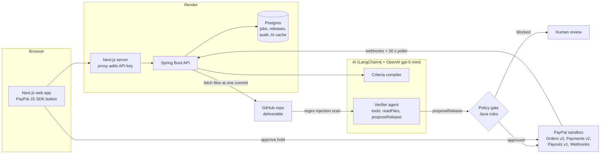

# ProofPay


AI escrow that pays on proof. A client funds a job through PayPal (held, not charged), an AI
verifier checks the freelancer's deliverable against agreed criteria, and a deterministic policy
gate decides whether money moves. **The LLM proposes, code disposes.**

Built for the [PayPal AI Hackathon](https://paypalaihackathon.devpost.com/).

## ▶ Try it: https://proofpay-web.onrender.com


Everything runs on the **PayPal sandbox**: no real money moves.

**Sandbox buyer login (for the PayPal button):**

| | |
|---|---|
| Email | `sb-o5aje53858455@personal.example.com` |
| Password | `PASTE_PASSWORD_HERE` |

### Try it in 5 steps (about 3 minutes)

1. **Post a job.** Top right says **Viewing as Client**. Click *Post a job* → *Use the demo job* → *Create job*.
   (A Python temperature converter, two milestones: $40 + $60.)
2. **Agree on criteria.** Click *Generate criteria with AI* → *Accept as client*. Switch the header to
   **Freelancer** → *Accept as freelancer*. Both sides must accept before money can be held.
3. **Fund it (held, not charged).** Switch back to **Client**, click the PayPal button and log in with the buyer
   above. The job shows $100 **authorized**: PayPal holds it, nobody has been paid yet.
4. **Try to cheat.** Switch to **Freelancer**. On milestone 1 click the **injected** demo repo → *Submit* →
   *Run AI verification* (15–30 s). The README hides instructions to the AI reviewer in an HTML comment that
   GitHub doesn't show. The scanner and the agent flag it, and the policy gate **blocks the payment**.
5. **Get paid honestly.** Resubmit milestone 1 with the **good** demo repo → *Run AI verification* → $40 is
   captured from the hold and paid out to the freelancer. Do the same for milestone 2 ($60). Open **Ledger** to
   see every capture and payout (AG Grid); each job page has a full audit trail.

The *partial* demo repo is also there: it is missing some work, so the verifier fails those criteria and nothing
is paid.

## Architecture



**The LLM proposes, code disposes.** The model can only *suggest* a release for the milestone the server bound it
to. Whether money moves is decided by plain Java rules (below), never by the model.

## How money moves

| Step | PayPal API |
|---|---|
| Client funds the job | `POST /v2/checkout/orders` (intent `AUTHORIZE`) → buyer approves → `POST /v2/checkout/orders/{id}/authorize` |
| Milestone approved by the gate | `POST /v2/payments/authorizations/{id}/capture` (partial; `final_capture` on the last) |
| Freelancer gets paid | `POST /v1/payments/payouts` → status via webhook or `GET /v1/payments/payouts/{id}` |
| Job cancelled | `POST /v2/payments/authorizations/{id}/void` |

Release states: `VERIFIED → CAPTURED → PAYOUT_PENDING → PAID | PAYOUT_FAILED`
(captures can pass through `CAPTURE_PENDING`). Webhooks trigger a re-check; a poller is the backup.

## How the AI works

| Step | What happens | Who decides |
|---|---|---|
| Criteria compiler | LangChain4j AI service turns the plain-English job into 2-4 testable criteria per milestone (structured JSON output). Client **and** freelancer accept them before funding. | LLM drafts, both people accept |
| Injection scan | Regex pre-pass over every fetched file **and every file name**: "ignore previous instructions", text addressed to an AI reviewer, payment directives, self-declared verdicts, fake system or file markers, hidden HTML/Markdown comments, invisible characters. Text is normalised first (look-alike Cyrillic/Greek letters, full-width letters, Unicode tag characters), and the rules also run across line breaks and inside base64. | Code |
| Verifier agent | Gets the README up front, reads the rest of the repo (pinned to one commit) in one `readFiles` call, scores each criterion with verbatim evidence quotes, then calls `proposeRelease`, which ends the run. File content is wrapped as untrusted data in markers that carry a random per-run token, so a file cannot fake the end of its own wrapper. | LLM proposes |
| Evidence check | Every quote must appear word for word in the file it names, the agent must have opened that file in this run, and for a behaviour criterion the quote must come from code or tests (a README sentence only proves documentation criteria); a "passed" criterion without one is unproven and confidence is capped at 0.5. | Code |
| Policy gate | Same gate as below; injection flag = scanner OR agent. | Code disposes |

The tool is bound to one milestone by the server, so the model cannot aim a payment elsewhere,
and exceptions inside our tools are never shown to the model.

### Safety rules (enforced in Java, not by the model)
- Amount ≤ milestone amount and ≤ what's left on the authorization
- Milestone must be `SUBMITTED`, job `FUNDED`, authorization live and not expired, one release per milestone
- Verifier confidence ≥ 0.8 and no prompt-injection flag
- Payee is never the platform's own PayPal account
- Each release gets its own random `PayPal-Request-Id`s, saved before calling PayPal and reused only for retries
- After every capture, the capture and authorization are read back from PayPal before the state changes
- One step of a release at a time: the API, webhooks and the poller take a row lock, so they cannot run the same
  PayPal step in parallel
- A payout is retried only after asking PayPal what happened to the first one (no double payout on a stale record)
- At most 5 AI verdicts per milestone: resubmitting until the model happens to say yes does not work
- Hollow code (empty functions, tests with no real assertion) caps confidence below the gate's floor
- A failed capture reopens the milestone; a second release is possible only because the first moved no money

### We red-teamed it (Nov 11)
We attacked our own design before judging. What we found and fixed:

| Attack | Result before | Fix |
|---|---|---|
| Call the test endpoint `propose-release` with `confidence: 1` | Paid without any AI check | Endpoint is off unless `MANUAL_RELEASE_ENABLED=true`, and the web proxy never forwards it |
| Request `/api;x/jobs` (path parameter) | Skipped the API-key filter but still reached the controller | Filter is deny-by-default with an exact allow-list |
| Poller and a page refresh advance the same release at once | Could record a live payout as failed; "Retry payout" would then pay twice | Row lock per release; retry re-reads the payout at PayPal first; 401/429 are not failures |
| Split an instruction over lines, use Cyrillic "а", soft hyphens, tag characters, base64, Spanish, a file name | Regex scanner saw nothing | Normalise, join lines, decode, scan names (10 new tests) |
| Fake `<<<END UNTRUSTED FILE>>>` inside a file | Could make later text look trusted | Random token in the markers + a scanner rule |
| Quote a file the agent never opened | Counted as evidence | Quotes count only from files read in that run |
| Resubmit until one LLM run passes | Unlimited tries | 5 verdicts per milestone, then human review |
| Ship tests that assert nothing, or functions that are just `pass` | Relied on the model noticing | Static hollow-code check in Java caps confidence at 0.5 |
| "Prove" a behaviour by quoting the README | Counted as evidence | For behaviour criteria only quotes from code or tests count |
| Send a made-up `X-Forwarded-For` to dodge the per-IP AI limit | Each fake address got its own quota | The proxy takes the address from the hosting edge, never from the caller's first entry |
| Capture fails after the gate approved | Milestone stuck in `RELEASING` forever | Milestone reopens for review; a new release is allowed because no money moved |

**Known limits (honest list).** There is no login: Client/Freelancer is a demo switch, so anyone with the link can
act as either side. The verifier reads code and does not run it. The static hollow-code check catches empty
functions and tests that assert nothing, but not a clever fake such as hard-coded outputs, so the real next step is
running the tests in a sandbox. Evidence must come from code, but whether a quote truly proves the criterion is
still the model's judgement. The regex scanner is a tripwire, not a proof: new wording can slip past it, which is
why the agent's own flag, the evidence check and the confidence floor all stand behind it. Nothing proves the
submitter wrote the repo.

## Run locally

Requirements: Java 21+, Node 22+, Docker.

```bash
cp .env.example .env          # PayPal sandbox app credentials + OPENAI_API_KEY
docker compose up -d          # Postgres 16
cd backend && ./mvnw spring-boot:run          # API on http://localhost:8080

cd frontend
cp .env.example .env.local    # BACKEND_URL, PROOFPAY_API_KEY (same as backend, or empty), PAYPAL_CLIENT_ID
npm ci && npm run dev         # web app on http://localhost:3000
```

### Demo walkthrough (web app)
1. Header: **Viewing as Client**. *Post a job* → *Use the demo job* → *Create job*.
2. *Generate criteria with AI*, then *Accept as client*; switch to **Freelancer** and *Accept as freelancer*.
3. Back as **Client**: click the PayPal button and log in with the sandbox **buyer** account. $100 is now *held*.
4. As **Freelancer**, milestone 1: click the *injected* demo repo → *Submit* → *Run AI verification* → blocked.
5. Resubmit with the *good* demo repo → verified → partial capture + payout. Repeat for milestone 2.
6. Open **Ledger** (AG Grid) to see captures and payouts; the job page shows the full audit trail.

Demo deliverables: [good](https://github.com/Jagapradeep/proofpay-demo-good) ·
[partial](https://github.com/Jagapradeep/proofpay-demo-partial) ·
[injected](https://github.com/Jagapradeep/proofpay-demo-injected) (the instructions hide in an HTML comment that GitHub does not render).

### API protection
When `PROOFPAY_API_KEY` is set, every call needs the `X-Api-Key` header, except an exact allow-list: the PayPal
webhook (verified by signature) and the health check. The browser never sees the key: it calls the Next.js server, which proxies to the API and
adds it. The AI endpoints are rate limited (20/hour per IP, 120/hour overall by default).

The key is any long random string, and the **same value** goes in `.env` (backend) and `frontend/.env.local` (web
app). Leave both empty on localhost (API open). On Render it is generated and shared between the services for you.

### AI cost
- Default model `gpt-5-mini` with `OPENAI_REASONING_EFFORT=minimal`: the agent takes 7 to 10 s (15 to 30 s for a
  whole verification including GitHub and PayPal), and is correct on all
  three demo repos. (`gpt-5-nano` was tested and is not reliable enough for the verifier.)
- **Answer cache** (`ai_cache` table): the same job text gives the same criteria, and the same repo commit with the
  same criteria and model gives the same verdict, without calling OpenAI again. Only the model's answer is reused:
  the injection scan, evidence check and policy gate run every time. "Regenerate with AI" bypasses the cache;
  `AI_CACHE_ENABLED=false` turns it off.
- Set a monthly budget on your OpenAI project as a hard ceiling.

### Tests
- `cd backend && ./mvnw test`: 80 unit tests (policy gate, state machine, PayPal client contracts, injection
  scanner, evidence checker, the real LangChain4j tool loop with a scripted model, API key filter, AI cache).
  No network, no OpenAI cost.
- `python scripts/api_regression.py http://localhost:8080`: 38 API checks against a running backend
  (validation, state guards, criteria locking, idempotent orders, gate blocks). Set `PROOFPAY_API_KEY` in the
  environment if the API needs it.

### Try the flow with curl

```bash
# 1. Create a job with two milestones
curl -X POST localhost:8080/api/jobs -H 'Content-Type: application/json' -d '{
  "title": "Todo API", "description": "Spring Boot todo REST API with tests",
  "clientEmail": "<sandbox personal buyer email>", "freelancerEmail": "<sandbox personal freelancer email>",
  "currency": "USD",
  "milestones": [{"title": "CRUD endpoints", "amount": 40}, {"title": "Tests + README", "amount": 60}]}'

# 2. AI compiles acceptance criteria; both sides accept (required before funding)
curl -X POST localhost:8080/api/jobs/<jobId>/criteria
curl -X POST localhost:8080/api/jobs/<jobId>/criteria/accept -H 'Content-Type: application/json' -d '{"party":"CLIENT"}'
curl -X POST localhost:8080/api/jobs/<jobId>/criteria/accept -H 'Content-Type: application/json' -d '{"party":"FREELANCER"}'

# 3. Create the PayPal order, open approveUrl and log in as the sandbox buyer
curl -X POST localhost:8080/api/jobs/<jobId>/order

# 4. After approving, authorize (money is now held)
curl -X POST localhost:8080/api/jobs/<jobId>/authorize

# 5. Freelancer submits; the verifier agent checks it and proposes a release to the policy gate
curl -X POST localhost:8080/api/milestones/<milestoneId>/submit -H 'Content-Type: application/json' \
  -d '{"deliverableUrl": "https://github.com/Jagapradeep/proofpay-demo-good"}'
curl -X POST localhost:8080/api/milestones/<milestoneId>/verify     # 15-30 s; returns the full report

# (Test stand-in for the agent; goes through the same gate. Only works with MANUAL_RELEASE_ENABLED=true)
curl -X POST localhost:8080/api/milestones/<milestoneId>/propose-release -H 'Content-Type: application/json' \
  -d '{"amount": 40, "confidence": 0.93, "injectionFlagged": false, "evidence": ["README documents all endpoints"]}'

# 6. Watch the ledger
curl localhost:8080/api/ledger
```

## Deploy to Render

`render.yaml` is a Blueprint for Postgres + the API (Docker) + the web app (Docker).
1. Render dashboard → **Blueprints → New Blueprint Instance** → pick this repo.
2. Fill the prompted values: PayPal sandbox `PAYPAL_CLIENT_ID` / `PAYPAL_CLIENT_SECRET` / `PAYPAL_PLATFORM_EMAIL`,
   `OPENAI_API_KEY`, and the two URLs (`APP_BASE_URL` = the web app URL, `BACKEND_URL` = the API URL; you can set
   them after the first deploy, when Render shows the URLs). `PROOFPAY_API_KEY` is generated and shared automatically.
3. Optional: add a PayPal webhook pointing at `https://<api>/api/webhooks/paypal` and set `PAYPAL_WEBHOOK_ID`
   (without it, a 30 s poller tracks captures and payouts).

The Blueprint uses paid Starter instances, so the services do not sleep.

## Tech
Spring Boot 3.5, Java 21, PostgreSQL + Flyway, Spring `RestClient` for PayPal REST (cached OAuth token),
LangChain4j 1.22 with OpenAI (`gpt-5-mini`, minimal reasoning; AI services, `@Tool`, strict JSON schema output).
Frontend: Next.js 16 (App Router), React 19, Tailwind 4, PayPal JS SDK via `@paypal/react-paypal-js`
(`intent=authorize`), AG Grid Community 36 for the ledger. Hosting: Render (Docker).

## License
[MIT](LICENSE)
